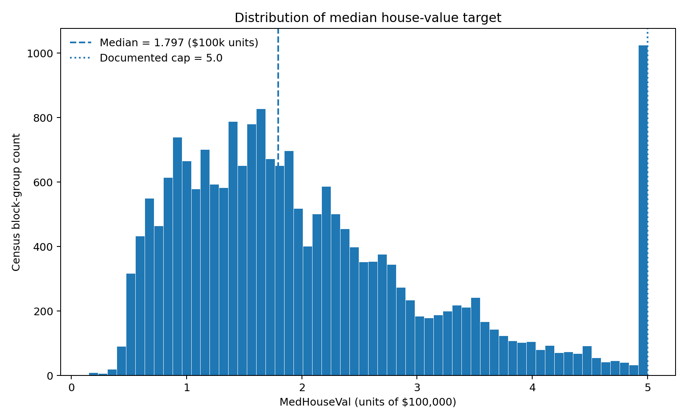
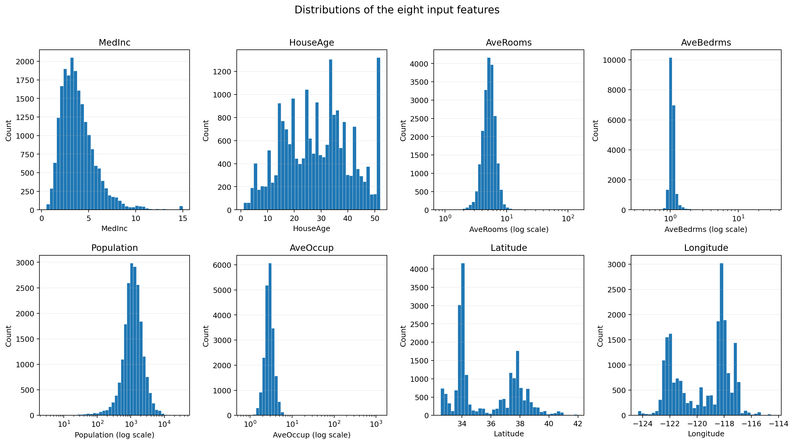
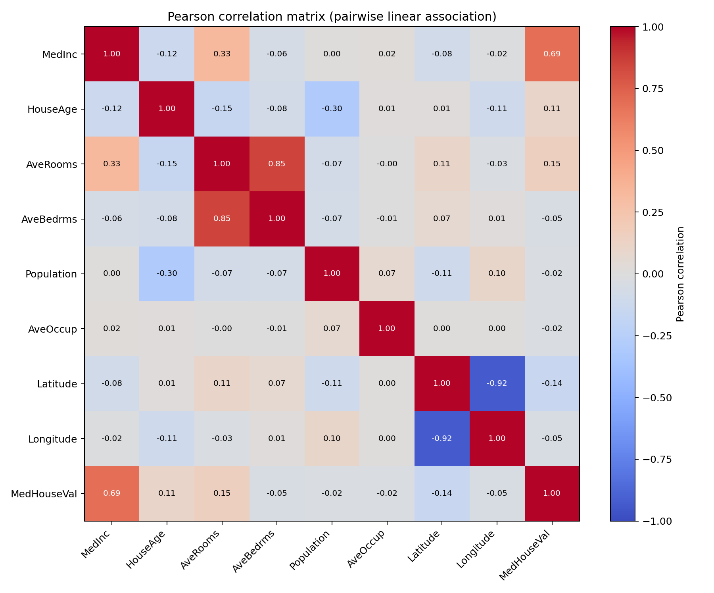
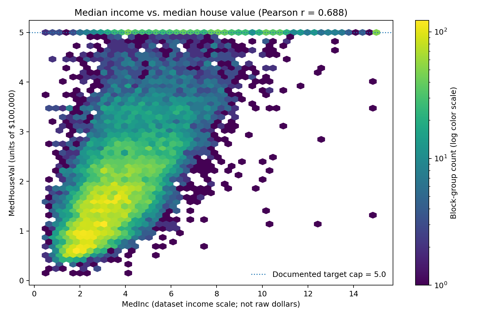
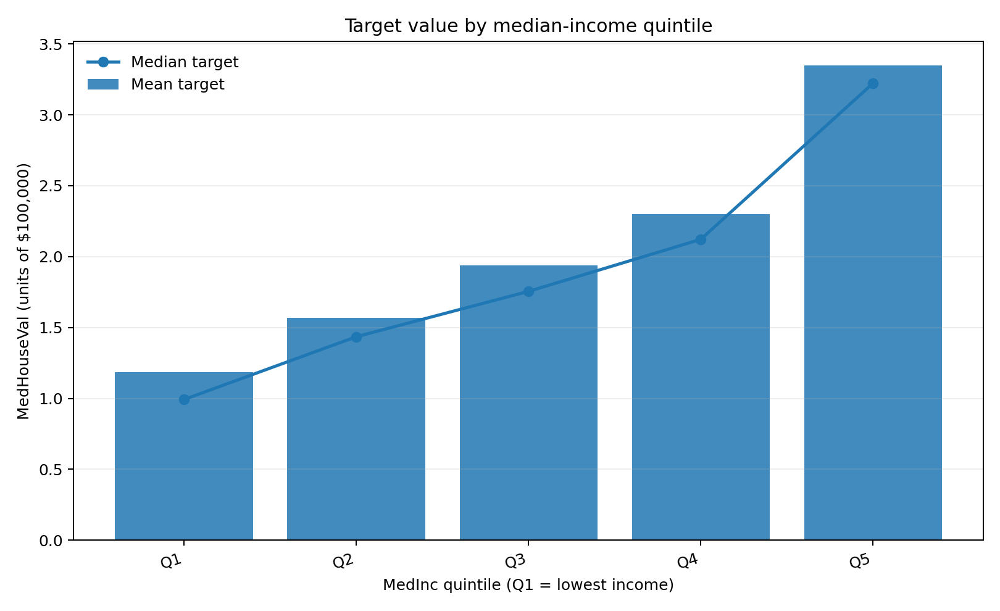
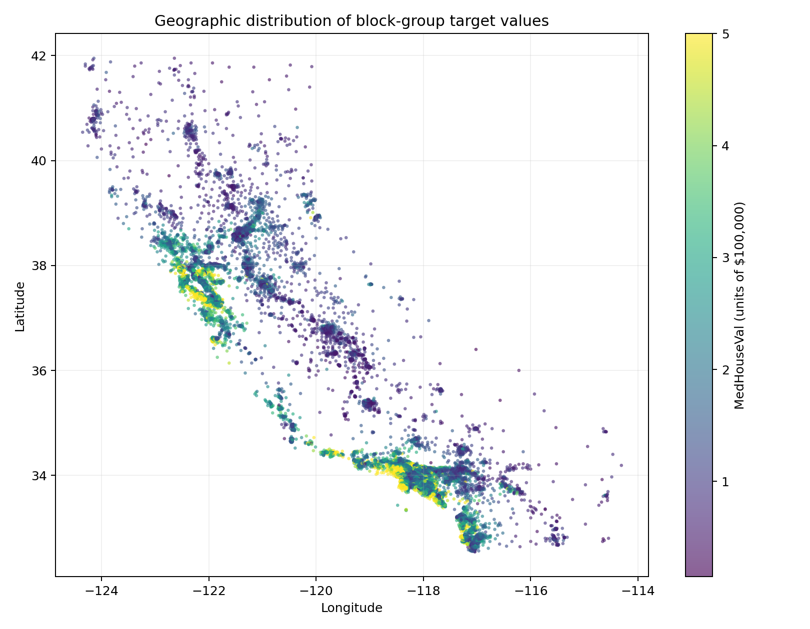

# California Housing — Data Quality Audit and Exploratory Analysis

**Report type:** Reviewed exploratory-analysis snapshot  
**Dataset:** California Housing dataset, represented as `california_housing.csv`  
**Dataset file SHA-256 (analyzed CSV):** `7192af0bf33e94141194cfd91958c62d66262dc40c07cc2e6fbe0b2d02b0e1b3`  
**Input size:** 1,915,795 bytes

## 1. Dataset provenance and source notes

The analyzed CSV is the California Housing dataset represented with eight numeric input features and the `MedHouseVal` target. The raw CSV is intentionally not bundled in this public portfolio package. To reproduce the analysis, run `python prepare_dataset.py`, which calls `sklearn.datasets.fetch_california_housing(as_frame=True)` and writes the returned frame to `data/california_housing.csv`.

The official scikit-learn documentation identifies StatLib as the original dataset source, describes 20,640 observations and eight input features, and explains that the observations derive from the 1990 U.S. Census at census-block-group level. It defines `MedHouseVal` in units of $100,000.

- [scikit-learn loader reference](https://scikit-learn.org/stable/modules/generated/sklearn.datasets.fetch_california_housing.html)
- [scikit-learn real-world dataset description](https://scikit-learn.org/stable/datasets/real_world.html)
- [scikit-learn implementation and reference metadata](https://github.com/scikit-learn/scikit-learn/blob/main/sklearn/datasets/_california_housing.py)
- [Original StatLib dataset archive](https://lib.stat.cmu.edu/datasets/houses.zip)

The SHA-256 above identifies the CSV artifact analyzed for this report snapshot. A newly prepared file should be audited independently; do not assume byte-for-byte identity if the source artifact or loader version changes. The observed target maximum is 5.00001, so the report preserves the value seen in the analyzed CSV rather than silently rounding it.

## 2. Structure and column dictionary

Observed dimension: **20,640 × 9**. Required/observed columns, order, types, missingness, unique values, and observed extrema are shown below. All columns are numeric; `HouseAge` and `Population` have `float64` CSV dtypes but are integer-valued in the observed records (see the range-check output).

| column      | dtype   | missing_count | unique_values | min        | median      | max          | meaning                                                                                       |
| ----------- | ------- | ------------- | ------------- | ---------- | ----------- | ------------ | --------------------------------------------------------------------------------------------- |
| MedInc      | float64 | 0             | 12,928        | 0.49990    | 3.53480     | 15.00010     | Median income in the block group; do not interpret as raw dollars without source context.     |
| HouseAge    | float64 | 0             | 52            | 1.00000    | 29.00000    | 52.00000     | Median house age in the block group.                                                          |
| AveRooms    | float64 | 0             | 19,392        | 0.84615    | 5.22913     | 141.90909    | Average number of rooms per household; can be unusually high for some block groups.           |
| AveBedrms   | float64 | 0             | 14,233        | 0.33333    | 1.04878     | 34.06667     | Average number of bedrooms per household; can be unusually high for some block groups.        |
| Population  | float64 | 0             | 3,888         | 3.00000    | 1,166.00000 | 35,682.00000 | Block-group population, not a household count.                                                |
| AveOccup    | float64 | 0             | 18,841        | 0.69231    | 2.81812     | 1,243.33333  | Average household occupants; aggregate ratio that can have extreme values.                    |
| Latitude    | float64 | 0             | 862           | 32.54000   | 34.26000    | 41.95000     | Block-group latitude.                                                                         |
| Longitude   | float64 | 0             | 844           | -124.35000 | -118.49000  | -114.31000   | Block-group longitude.                                                                        |
| MedHouseVal | float64 | 0             | 3,842         | 0.14999    | 1.79700     | 5.00001      | Median house-value target, in units of $100,000; documentation describes an upper cap of 5.0. |

## 3. Data-quality audit

### Missing values and exact duplicates

Total missing cells: **0** across the dataset. Exact duplicate rows beyond first occurrence: **0**. Non-finite values among numeric cells: **0**. Missing counts by column:

| column      | missing_count | missing_percent |
| ----------- | ------------- | --------------- |
| MedInc      | 0             | 0               |
| HouseAge    | 0             | 0               |
| AveRooms    | 0             | 0               |
| AveBedrms   | 0             | 0               |
| Population  | 0             | 0               |
| AveOccup    | 0             | 0               |
| Latitude    | 0             | 0               |
| Longitude   | 0             | 0               |
| MedHouseVal | 0             | 0               |

A zero missing count supports that no CSV cell is blank/recognized as missing by pandas' default CSV parser. It does not prove the data is historically accurate or semantically correct. A zero duplicate count only checks exact equality across all nine fields; it does not identify near-duplicates or repeated geographic units represented with slightly different values.

### Range, domain, and unusual-observation checks


| check                                    | rule                                                              | observed_violations | status |
| ---------------------------------------- | ----------------------------------------------------------------- | ------------------- | ------ |
| MedInc positive                          | MedInc > 0                                                        | 0                   | PASS   |
| HouseAge within plausible observed range | 1 <= HouseAge <= 52                                               | 0                   | PASS   |
| AveRooms positive                        | AveRooms > 0                                                      | 0                   | PASS   |
| AveBedrms positive                       | AveBedrms > 0                                                     | 0                   | PASS   |
| Population non-negative                  | Population >= 0                                                   | 0                   | PASS   |
| AveOccup positive                        | AveOccup > 0                                                      | 0                   | PASS   |
| Latitude geographic bounds               | -90 <= Latitude <= 90                                             | 0                   | PASS   |
| Longitude geographic bounds              | -180 <= Longitude <= 180                                          | 0                   | PASS   |
| Target non-negative                      | MedHouseVal >= 0; the documented upper cap is audited separately  | 0                   | PASS   |
| HouseAge integer-valued                  | HouseAge values are whole-number coded                            | 0                   | PASS   |
| Population integer-valued                | Population values are whole-number counts despite float CSV dtype | 0                   | PASS   |

An additional upper-cap review found max `MedHouseVal` = **5.00001**; **992** rows are `>= 5.0`, of which **965** equal `5.00001`. This is reported as a documentation/data-value precision discrepancy, not automatically treated as corruption. The dataset notes caution that high `AveRooms` / `AveBedrms` values can occur in block groups with few households and many vacant homes, and that aggregate-ratio values can be unusually large. The observed maxima are `AveRooms` = **141.9091**, `AveBedrms` = **34.0667**, and `AveOccup` = **1243.3333**. These deserve contextual inspection, but extremes alone do not justify deletion.

The 1.5×IQR screen below is a statistical flagging convention, not a claim that flagged rows are errors. It is provided for review only; it did not trigger any filtering.

| feature     | q1     | q3     | iqr    | lower_fence | upper_fence | below_lower_fence | above_upper_fence | iqr_flag_count | interpretation                                                               |
| ----------- | ------ | ------ | ------ | ----------- | ----------- | ----------------- | ----------------- | -------------- | ---------------------------------------------------------------------------- |
| AveRooms    | 4.4407 | 6.0524 | 1.6117 | 2.0232      | 8.4699      | 45                | 466               | 511            | Screening flag only; not evidence of invalidity and not used to filter rows. |
| AveBedrms   | 1.0061 | 1.0995 | 0.0934 | 0.8659      | 1.2397      | 188               | 1,236             | 1,424          | Screening flag only; not evidence of invalidity and not used to filter rows. |
| AveOccup    | 2.4297 | 3.2823 | 0.8525 | 1.1510      | 4.5610      | 7                 | 704               | 711            | Screening flag only; not evidence of invalidity and not used to filter rows. |
| MedHouseVal | 1.1960 | 2.6472 | 1.4512 | -0.9809     | 4.8241      | 0                 | 1,071             | 1,071          | Screening flag only; not evidence of invalidity and not used to filter rows. |

## 4. Preparation decision and change log

**No transformation was justified by the evidence gathered for this task.** No rows were deleted, no values rounded, no columns engineered, and no missing values imputed. The CSV remains unchanged. A separate “cleaned” CSV was therefore not created. The feature distributions and unusual records are retained for transparent downstream interpretation. If a later task requires a filtered or transformed analysis, the rule should be agreed and documented first, with before/after counts.

## 5. Descriptive statistics

The complete per-column summary (including 1st, 5th, 25th, 50th, 75th, 95th, and 99th percentiles) is available as `tables/descriptive_statistics.csv`. Selected summary statistics:

| column      | mean        | std         | min        | p25        | p50         | p75         | p95         | max          | skew     |
| ----------- | ----------- | ----------- | ---------- | ---------- | ----------- | ----------- | ----------- | ------------ | -------- |
| MedInc      | 3.87067     | 1.89982     | 0.49990    | 2.56340    | 3.53480     | 4.74325     | 7.30030     | 15.00010     | 1.64666  |
| HouseAge    | 28.63949    | 12.58556    | 1.00000    | 18.00000   | 29.00000    | 37.00000    | 52.00000    | 52.00000     | 0.06033  |
| AveRooms    | 5.42900     | 2.47417     | 0.84615    | 4.44072    | 5.22913     | 6.05238     | 7.64025     | 141.90909    | 20.69787 |
| AveBedrms   | 1.09668     | 0.47391     | 0.33333    | 1.00608    | 1.04878     | 1.09953     | 1.27301     | 34.06667     | 31.31696 |
| Population  | 1,425.47674 | 1,132.46212 | 3.00000    | 787.00000  | 1,166.00000 | 1,725.00000 | 3,288.00000 | 35,682.00000 | 4.93586  |
| AveOccup    | 3.07066     | 10.38605    | 0.69231    | 2.42974    | 2.81812     | 3.28226     | 4.33342     | 1,243.33333  | 97.63956 |
| Latitude    | 35.63186    | 2.13595     | 32.54000   | 33.93000   | 34.26000    | 37.71000    | 38.96000    | 41.95000     | 0.46595  |
| Longitude   | -119.56970  | 2.00353     | -124.35000 | -121.80000 | -118.49000  | -118.01000  | -117.08000  | -114.31000   | -0.29780 |
| MedHouseVal | 2.06856     | 1.15396     | 0.14999    | 1.19600    | 1.79700     | 2.64725     | 4.89810     | 5.00001      | 0.97776  |

Selected target observations: mean = **2.0686** and median = **1.7970** in units of $100,000. These describe the historical target values in the dataset; they are not present-day California market prices or forecasts.

## 6. Correlation and feature/target comparisons

Pearson correlations describe linear association; Spearman correlations describe rank-order association. Correlation can be affected by the target cap and by geographic or other unmeasured structure. Neither coefficient establishes causality.

| feature    | pearson_r | spearman_rho |
| ---------- | --------- | ------------ |
| MedInc     | 0.6881    | 0.6768       |
| AveRooms   | 0.1519    | 0.2634       |
| Latitude   | -0.1442   | -0.1657      |
| HouseAge   | 0.1056    | 0.0749       |
| AveBedrms  | -0.0467   | -0.1252      |
| Longitude  | -0.0460   | -0.0697      |
| Population | -0.0246   | 0.0038       |
| AveOccup   | -0.0237   | -0.2566      |

For a quintile comparison, observations are ranked into five near-equal-sized groups by `MedInc` using pandas `qcut`. Group boundaries are determined from the actual input values at runtime. The table reports counts, median income, and mean/median target for each group:

| income_group | n     | median_MedInc | mean_MedHouseVal | median_MedHouseVal |
| ------------ | ----- | ------------- | ---------------- | ------------------ |
| Q1           | 4,130 | 1.9038        | 1.1840           | 0.9920             |
| Q2           | 4,131 | 2.7411        | 1.5703           | 1.4350             |
| Q3           | 4,123 | 3.5352        | 1.9389           | 1.7550             |
| Q4           | 4,128 | 4.4375        | 2.3003           | 2.1220             |
| Q5           | 4,128 | 6.1593        | 3.3499           | 3.2230             |

Observed pattern: mean `MedHouseVal` increases across the observed income quintiles, from 1.1840 in the lowest-income quintile to 3.3499 in the highest-income quintile. This is descriptive, not causal, and the upper target cap compresses distinctions among high-value observations.

## 7. Figures

The generated figures use the original observations and do not require a separate cleaned dataset. Feature distributions use log-scaled x-axes for the positive, right-skewed `AveRooms`, `AveBedrms`, `Population`, and `AveOccup` dimensions so their long tails remain visible without removing records.













## 8. Limitations and interpretation cautions

- **Historical scope:** the dataset is derived from the 1990 U.S. Census. It cannot support claims about current (2026) California house prices without separate current data and a newly scoped analysis.
- **Aggregation:** each row is a census block-group summary, not one individual property or transaction. Treating 20,640 rows as 20,640 house listings would be incorrect.
- **Target units and cap:** `MedHouseVal` is in units of $100,000. Supplied documentation describes an upper cap of 5.0; the uploaded CSV contains 992 values at/above 5.0 and 965 exact values of 5.00001. This run preserves the observed values and notes the discrepancy rather than silently normalizing it.
- **Unusual ratio values:** room/bedroom/occupancy aggregates may have large values in small or atypical block groups. Extreme values are flagged, not automatically classified as bad data.
- **Correlation is not causation:** relationships can reflect confounding, spatial structure, aggregation, and capping.
- **No model:** no predictive model was trained or tuned, and no prediction/forecast or policy/investment recommendation was made.
- **Source verification:** the official scikit-learn references are linked above and were consulted during portfolio preparation. The exact CSV used for this report snapshot is identified by the SHA-256 value at the top; this snapshot does not claim that the file was freshly downloaded during publication preparation.

## 9. Reproduction

From the repository root, install the documented dependencies and prepare the raw CSV (the raw data file is not committed):

```powershell
python -m pip install -r requirements.txt
python prepare_dataset.py
python housing_analysis.py
```

By default the script reads `data/california_housing.csv` relative to its own location and writes generated tables, figures, a JSON metadata file, and a regenerated report to `outputs/`. Optional `--input` and `--output-dir` arguments allow alternate paths. The script reads but does not modify the source CSV. The generated runtime metadata records local absolute paths and is therefore intentionally excluded from version control by `.gitignore`.

## 10. Published aggregate evidence files

The public repository includes selected aggregate tables under `tables/`:

- `tables/column_schema.csv` — observed column types, missing counts, unique values, observed extrema, and definitions.
- `tables/missing_values.csv` and `tables/data_quality_summary.csv` — missingness and core quality summaries.
- `tables/range_checks.csv` — rule-based checks and observed violation counts.
- `tables/descriptive_statistics.csv` — summary statistics and percentiles.
- `tables/correlation_matrix.csv`, `tables/spearman_correlation_matrix.csv`, and `tables/target_correlations.csv` — Pearson and Spearman analyses.
- `tables/income_quintile_comparison.csv` — target comparison by median-income quintile.
- `tables/iqr_screening.csv` — aggregate screening summaries only; flags are not evidence of invalidity.

Machine-specific runtime metadata and row-level unusual-observation listings are not included in this public snapshot. They are not necessary to communicate the main findings and may contain local-path or row-level derived details.

---

**Interpretation note:** this is a data-quality and exploratory-analysis report, not a model evaluation or current real-estate valuation exercise.
